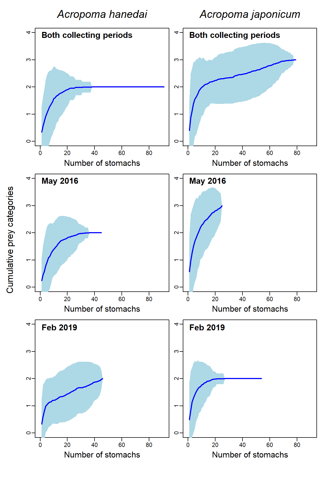

```{r, include = F}
# Load in data and packages
# setwd("/PATH_HERE")
fish_data_wide <- read.csv("data/fish_data_wide.csv")
fish_data_long_summed <- read.csv("data/fish_data_long_summed.csv")
library(tidyverse)
library(ggplot2)
library(glmmTMB)
library(multcomp)
library(indicspecies)
library(vegan)
library(glue)
library(scales)
library(gt)
library(gridExtra)
library(grid)
library(conflicted)
conflicts_prefer(dplyr::select, dplyr::filter, dplyr::lag)
```

## Question 1: How do the two species differ in average standard length by season?

First we can create a simple boxplot visual showing difference in Month, Species, and Standard Length with a cutoff line for Size Class:

```{r, echo = F}
SMSLBoxplotbw <- ggplot(fish_data_wide, aes(x = Species, y = SL, fill = Month)) +
  geom_boxplot(alpha = 0.6) +
  xlab("Species") +
  ylab("Standard Length (mm)") +
  geom_hline(aes(yintercept = 60, color = "Size Class"), linetype = "dashed") +
  scale_color_manual(name = "", values = c("Size Class" = "black")) +
  scale_fill_grey() +
  theme_minimal() +
  scale_x_discrete(labels = function(x) {
    lapply(x, function(label) bquote(italic(.(label))))
  }) +
   theme(
    axis.title = element_text(size = 20),      
    axis.text = element_text(size = 16),        
    legend.text = element_text(size = 14),      
    legend.title = element_text(size = 17)      
  )
#SMSLBoxplotbw


SMSLBoxplotcol <- ggplot(fish_data_wide, aes(x = Species, y = SL, fill = Month)) +
  geom_boxplot(alpha = 0.9) +
  xlab("Species") +
  ylab("Standard Length (mm)") +
  geom_hline(aes(yintercept = 60, color = "Size Class"), linetype = "dashed") +
  scale_color_manual(name = "", values = c("Size Class" = "black")) +
  theme_minimal() +
  scale_fill_manual(values = c("Feb" = "royalblue1", "May" = "orange")) +
  scale_x_discrete(labels = function(x) {
    lapply(x, function(label) bquote(italic(.(label))))
  }) +
   theme(
    axis.title = element_text(size = 20),       
    axis.text = element_text(size = 16),        
    legend.text = element_text(size = 14),     
    legend.title = element_text(size = 17)      
  )
SMSLBoxplotcol


##ggsave(filename = "figures/SpeciesMonthSLBoxplotbw.jpg", plot = SMSLBoxplotbw, width = 8, height = 6, dpi = 300)
##ggsave(filename = "figures/SpeciesMonthSLBoxplotcol.jpg", plot = SMSLBoxplotcol, width = 8, height = 6, dpi = 300)

```


```{r, include=F}
distplot <- ggplot(fish_data_wide, aes(x = SL, fill = Species)) +
  geom_density(alpha = 0.4) +
  theme_minimal()
distplotlog <- ggplot(fish_data_wide, aes(x = log(SL), fill = Species)) +
  geom_density(alpha = 0.4) +
  theme_minimal()
distplot
distplotlog
```


After log transforming our Standard Length values to normalize them, we can create various linear models based on Species and Month w/ interactions, either predicting standard length or size class and also including a random effect of the "Master Jar" indicating which collection lot each fish came from. Additionally, we can compute AIC values for each model to help determine selection.  

This leads us to our main linear model predicting log(Standard Length) with Species and Month, including interactions and random effect of master jars. 


```{r, include = F}
#(1) For a linear model predicting log(SL) with Species, Month and interactions:
SMSLInlmModel <- lm(log(SL) ~ Month + Species + Month:Species, data  = fish_data_wide)
summary(SMSLInlmModel)
AIC(SMSLInlmModel)
```

```{r, include = F}
#(2) For a linear model predicting log(SL) with Species and Month not including interactions:
SMSLlmModel <- lm(log(SL) ~ Month + Species, data  = fish_data_wide)
summary(SMSLlmModel)
AIC(SMSLlmModel)
```

```{r, echo = F}
#(3) For a linear model predicting log(SL) with Species and Month, including interactions and random effect of master jars: (WILL BE MAIN LINEAR MODEL FOR ANALYSIS)
SMSLInRelmModel <- glmmTMB(log(SL) ~ Species + Month + Species:Month + (1|MJar), data = fish_data_wide, family = gaussian(link = "identity"))
summary(SMSLInRelmModel)
#AIC(SMSLInRelmModel)
```

We can see that fish in May are predicted to be significantly larger (p = 0.000808) than fish in February. Additionally, A. Japonicum are also significantly larger than A. Hanedai (p = 0.001179).

```{r, include = F}
#(4) For a generalized linear model predicting SClass with Species and Month including interactions:
SMSCInglmModel <- glm(SClass ~ Species + Month + Species:Month, data = fish_data_wide, family = binomial(link = 'logit'))
summary(SMSCInglmModel)
AIC(SMSCInglmModel)
```

```{r, include = F}
#(5) For a generalized linear model predicting SClass with Species and Month including interactions:
SMSCInReglmModel <- glmmTMB(SClass ~ Species + Month + Species:Month + (1|MJar), data = fish_data_wide, family = binomial(link = 'logit'))
summary(SMSCInReglmModel)
AIC(SMSCInReglmModel)
```

```{r, include = F}
#Now, to summarize all AIC values:
#(Key (in order): S = Species, M = Month, SL/SC = log(SL) or SClass, In = Interaction, Re = Random effect, lm/glm = generalized/not)
AIC(SMSLInlmModel)
AIC(SMSLlmModel)
AIC(SMSLInRelmModel)
AIC(SMSCInglmModel)
AIC(SMSCInReglmModel)
```


## Question 2: Does a fish having any stomach content have bias in size, species or month?

We now can look at whether or not size, species, month and their interactions had an effect on if a fish had any stomach contents at all, fit as a logistic regression model for a binomial response.


```{r}
#(1) For a generalized linear model predicting Content with Standard Length, Species and Month including interactions:
ContVarglmModel <- glmmTMB(Content ~ SL + Species + Month + SL:Species + SL:Month + Species:Month + SL:Species:Month + (1|MJar), data = fish_data_wide, family = binomial(link = 'logit'))
#summary(ContVarglmModel)
AIC(ContVarglmModel)
```


```{r, include = F}
#AIC increased by 2 after accounting for random effect of MJar
model1 <- glmmTMB(Content ~ 1 + (1|MJar), data = fish_data_wide, family = binomial(link = 'logit'))
summary(model1)
invlogit2 <- (exp(-0.3475))/(1+(exp(-0.3475)))
invlogit2
```


```{r, include = F}
ContVarglmModel1 <- glmmTMB(Content ~ as.factor(SClass) + Species + Month + as.factor(SClass):Species + as.factor(SClass):Month + Species:Month + as.factor(SClass):Species:Month + (1|MJar), data = fish_data_wide, family = binomial(link = 'logit'))
summary(ContVarglmModel1)
AIC(ContVarglmModel1)
#AIC increased by 2 after accounting for random effect of MJar
#ContglmModel2 <- glm(Content ~ Month, data = fish_data_wide, family = binomial(link = 'logit'))
#summary(ContglmModel2)
```


```{r}
#(2) For a generalized linear model predicting Content based on only intercept
ContglmModel <- glm(Content ~ 1, data = fish_data_wide, family = binomial(link = 'logit'))

AIC(ContglmModel)

```

After running several models to predict the presence of any stomach content in a fish based on size, species, and month, we find that there is no significant effect of any variable.

```{r, include = F}
# We can see that the AIC score of the models predicting content without variables is actually lower, and by computation of our inverse logit function and comparison with proportion of which fish have content or don't, we can see that there isn't a difference.
AIC(ContVarglmModel)
AIC(ContglmModel)
invlogit <- (exp(-0.2843))/(1+(exp(-0.2843)))
contprop <- sum(fish_data_wide$Content)/170
invlogit
contprop
```


## Question 3: Now using our selected linear model, what is the 95% confidence intervals for the standard length of each combination of species and month?

General linear hypothesis tests of log(SL) of each combination of species and month as predicted from our model:


```{r, echo = F}
hanfeb <- c(1,0,0,0)
hanmay <- c(1,0,1,0)
japfeb <- c(1,1,0,0)
japmay <- c(1,1,1,1)

K_fish <- rbind(hanfeb, hanmay, japfeb, japmay)
fish.glht <- glht(SMSLInRelmModel, linfct = K_fish)
ci <- confint(fish.glht, calpha=univariate_calpha())


summary(fish.glht, test = adjusted(type = "none"))

```

Here are the exponentiated 95% CIs for Standard Length of each combination of species and month as predicted from our model.

```{r, echo = F}
exp_ci  <- as.data.frame(exp(ci$confint))
exp_ci

```


## Question 4: To what degree are each combination of species, month, and size class associated with diet composition?

We can first convert out data into Bray-Curtis dissimilarity matrices either by total biovolume or occurance (coded as 0 or 1), then perform a PERMANOVA to see which covariates have a significant effect on the matrix.


First, predicting stomach composition by biovolume:


```{r, echo = F}
# Bray Curtis Dissimilarity, PermANOVA, PCoA, NMDS
#fishBCdat is species trait data
#BC dissimilarity/PermANOVA
fishBCdat <- filter(fish_data_wide, Content != 0)
fishBCdat <- fishBCdat %>% 
  mutate(Individual = row_number())
  
  
fishBCdat2 <- fishBCdat %>% select(animal:mollusk) %>% sqrt()


BCmat <- vegdist(fishBCdat2)
set.seed(123)

permanova <- adonis2(BCmat ~ SL + Species + Month + SL:Species + SL:Month + Species:Month + SL:Species:Month, data = fishBCdat, by = "terms")

permanova2 <- adonis2(BCmat ~ Species + Month + SClass + Species:Month + SClass:Species + SClass:Month  + SClass:Species:Month, data = fishBCdat, by = "terms")

print(permanova2)
```

Second, predicting stomach composition by frequency of occurrence (whether or not that type of content was present represented as either 0 or 1):


```{r, echo = F}
fishBCdat <- fishBCdat %>% mutate(animalcount = ifelse(animal > 0, 1, 0))
fishBCdat <- fishBCdat %>% mutate(crustaceancount = ifelse(crustacean > 0, 1, 0))
fishBCdat <- fishBCdat %>% mutate(fishcount = ifelse(fish > 0, 1, 0))
fishBCdat <- fishBCdat %>% mutate(molluskcount = ifelse(mollusk > 0, 1, 0))
  
  
fishBCdat3 <- fishBCdat %>% select(animalcount:molluskcount) %>% sqrt()


BCmat2 <- vegdist(fishBCdat3)


permanovafreq <- adonis2(BCmat2 ~ SL + Species + Month + SL:Species + SL:Month + Species:Month + SL:Species:Month, data = fishBCdat, by = "terms")

permanovafreq2 <- adonis2(BCmat2 ~ Species + Month + SClass + Species:Month + SClass:Species + SClass:Month + SClass:Species:Month, data = fishBCdat, by = "terms")


permanovafreq2

```


From these calculated PermANOVAs, we can see that after predicting stomach composition by biovolume, ~18% of the variation is accounted for by species and interaction with month, even after accounting for the variation in size classes. For the PermANOVA predicting stomach composition by frequency of occurrence, this variation by species and interaction with month jumps up to ~22% after accounting for variation in size classes.


```{r, include = F}
pcoa <- wcmdscale(BCmat, eig = T)
#print(pcoa)
#ordiplot(pcoa, display = 'sites', type = 'text')

pcoa_df <- data.frame(pcoa$points)
pcoa_df$Species <- factor(fishBCdat$Species)
pcoa_df$Month <- factor(fishBCdat$Month)


variation <- pcoa$eig / sum(pcoa$eig) * 100
#variation[1] #50.83807
#variation[2] #28.29742
#variation[3] #10.92235


rounded_var <- format(round(variation[1:2], digits = 2), nsmall = 1, trim = T)

labs <- c(glue("PCO1 ({rounded_var[1]}% of total variation)"),
          glue("PCO2 ({rounded_var[2]}% of total variation)"))

#ggplot(data = pcoa_df,
#aes(x = Dim1, y = Dim2, color = Species)) +
#geom_point(aes(shape = Month)) +
#labs(x=labs[1], y= labs[2]) +
#theme_minimal()


en <- envfit(ord = pcoa, env = fishBCdat2)
en_coord_cont <- as.data.frame(scores(en, "vectors")) * ordiArrowMul(en)


ggplot(data = pcoa_df,
aes(x = Dim1, y = Dim2, color = Species)) +
geom_segment(aes(x = 0, y = 0, xend = Dim1, yend = Dim2), data = en_coord_cont, color = "black") +
geom_text(data = en_coord_cont, aes(x = Dim1, y = Dim2), label = row.names(en_coord_cont), color = "black", vjust = -1) + 
geom_point(aes(shape = Month)) +
geom_jitter(height = 0.1, width = 0.05) +
labs(x=labs[1], y= labs[2]) +
theme_minimal()

```


```{r, include=F}
#set.seed(10042003)
#nmds <- metaMDS(BCmat)
#nmds
#plot(nmds)
#stressplot (nmds)


#fishBCdat$Individual <- as.character(fishBCdat$Individual)

#nmds_p <- scores(nmds) %>% as_tibble(rownames="Individual")
#nmds_pmerge <- nmds_p %>% 
  #left_join(fishBCdat %>% select(Individual, Species, Month), by = "Individual")
#nmds_pmerge


#en2 <- envfit(ord = nmds, env = fishBCdat2)
#en_coord_cont2 <- as.data.frame(scores(en2, "vectors")) * ordiArrowMul(en2)


#ggplot(data = nmds_pmerge,
#aes(x = NMDS1, y = NMDS2, color = Species)) +
#geom_point(aes(shape = Month)) +
#theme_minimal()


#ggplot(data = nmds_pmerge,
#aes(x = NMDS1, y = NMDS2, color = Species)) +
#geom_segment(aes(x = 0, y = 0, xend = NMDS1, yend = NMDS2), data = en_coord_cont2, color = "black") +
#geom_text(data = en_coord_cont2, aes(x = NMDS1, y = NMDS2), label = row.names(en_coord_cont), color = "black", vjust = -1) + 
#geom_point(aes(shape = Month)) +
#theme_minimal()
```


We can also visually display these differences for each combinations of species and month for both total biovolume and frequency of occurrence with stacked barcharts.


```{r, echo = F}

fishbardat <- filter(fish_data_long_summed, Vol != 0)
fishbardat <- fishbardat %>% mutate(Count = ifelse(Vol > 0, 1, 0))
fishbardat <- fishbardat %>% 
  mutate(
    SClass = ifelse(SL >= 60, "Large", "Small")
  )

fishbardat <- fishbardat %>%
  mutate(interaction_col = factor(interaction(Species, Month),
                                  levels = c("Acropoma hanedai.Feb", "Acropoma hanedai.May", "Acropoma japonicum.Feb", "Acropoma japonicum.May")))

fishbardat$Category[fishbardat$Category=="animal"] <- "unident. animal"
fishbardat$Category[fishbardat$Category=="fish"] <- "teleost"


fishbardat$Category <- factor(fishbardat$Category, levels = c("unident. animal", "mollusk", "crustacean", "teleost"))


barlabels <- c(
  "Acropoma hanedai.Feb" = "Han Feb",
  "Acropoma hanedai.May" = "Han May",
  "Acropoma japonicum.Feb" = "Jap Feb",
  "Acropoma japonicum.May" = "Jap May"
)


poccurscl <- ggplot(fishbardat, aes(fill = Category, y = Count, x = SClass)) +
  geom_bar(position = "fill", stat = "identity") +
  scale_fill_grey() +
  scale_y_continuous(labels = label_percent(scale = 100)) +
  labs(x = "Size Class", y = "Percentage of Occurence", fill = "Category") +
  theme_bw()
#poccurscl


pvolscl <- ggplot(fishbardat, aes(fill = Category, y = Vol, x = SClass)) +
  geom_bar(position = "fill", stat = "identity") +
  scale_fill_grey() +
  scale_y_continuous(labels = label_percent(scale = 100)) +
  labs(x = "Size Class", y = "Percentage of Volume", fill = "Category") +
  theme_bw()
#pvolscl


poccurspmcol <- ggplot(fishbardat, aes(fill = Category, y = Count, x = interaction_col)) +
  geom_bar(position = "fill", stat = "identity") +
  scale_x_discrete(labels = barlabels) + 
  scale_y_continuous(labels = label_percent(scale = 100)) +
  scale_fill_manual(
    values = c(
      "unident. animal" = "gray10",  # Lightest shade
      "mollusk" = "yellow",  # Medium shade
      "crustacean" = "tomato3",   # Darkest shade
      "teleost" = "purple3"
    )
  ) +
  labs(x = "Species and Month", y = "Percentage of Occurence", fill = "Category") +
  theme_bw()+
   theme(
    axis.title = element_text(size = 20),       # axis title size
    axis.text = element_text(size = 16),        # species title size
    legend.text = element_text(size = 14),      # month label size
    legend.title = element_text(size = 17)      # legend text size
  )
poccurspmcol


poccurspm <- ggplot(fishbardat, aes(fill = Category, y = Count, x = interaction_col)) +
  geom_bar(position = "fill", stat = "identity") +
  scale_x_discrete(labels = barlabels) + 
  scale_y_continuous(labels = label_percent(scale = 100)) +
  scale_fill_manual(
    values = c(
      "unident. animal" = "gray10",  # Lightest shade
      "mollusk" = "gray27",  # Medium shade
      "crustacean" = "gray50",   # Darkest shade
      "teleost" = "gray80"
    )
  ) +
  labs(x = "Species and Month", y = "Percentage of Occurence", fill = "Category") +
  theme_bw() +
   theme(
    axis.title = element_text(size = 20),       # axis title size
    axis.text = element_text(size = 16),        # species title size
    legend.text = element_text(size = 14),      # month label size
    legend.title = element_text(size = 17)      # legend text size
  )
#poccurspm


pvolspm <- ggplot(fishbardat, aes(fill = Category, y = Vol, x = interaction_col)) +
  geom_bar(position = "fill", stat = "identity") +
  scale_x_discrete(labels = barlabels) + 
  scale_y_continuous(labels = label_percent(scale = 100)) +
  labs(x = "Species and Month", y = "Percentage of Volume", fill = "Category") +
  theme_bw() +
  scale_fill_manual(
    values = c(
      "unident. animal" = "gray10",  # Lightest shade
      "mollusk" = "gray27",  # Medium shade
      "crustacean" = "gray50",   # Darkest shade
      "teleost" = "gray80"
    )
  ) +
  theme_bw() +
   theme(
    axis.title = element_text(size = 20),       # axis title size
    axis.text = element_text(size = 16),        # species title size
    legend.text = element_text(size = 14),      # month label size
    legend.title = element_text(size = 17)      # legend text size
  )
#pvolspm


pvolspmcol <- ggplot(fishbardat, aes(fill = Category, y = Vol, x = interaction_col)) +
  geom_bar(position = "fill", stat = "identity") +
  scale_x_discrete(labels = barlabels) + 
  scale_y_continuous(labels = label_percent(scale = 100)) +
  labs(x = "Species and Month", y = "Percentage of Volume", fill = "Category") +
  theme_bw() + 
  scale_fill_manual(
    values = c(
      "unident. animal" = "gray10",  # Lightest shade
      "mollusk" = "yellow",  # Medium shade
      "crustacean" = "tomato3",   # Darkest shade
      "teleost" = "purple3"
    )
  ) +
  theme_bw()+
   theme(
    axis.title = element_text(size = 20),       # axis title size
    axis.text = element_text(size = 16),        # species title size
    legend.text = element_text(size = 14),      # month label size
    legend.title = element_text(size = 17)      # legend text size
  )
pvolspmcol


##ggsave(filename = "figures/SpmOccurBarbw.jpg", plot = poccurspm, width = 8, height = 6, dpi = 300)
##ggsave(filename = "figures/SpmOccurBarcol.jpg", plot = poccurspmcol, width = 8, height = 6, dpi = 300)
##ggsave(filename = "figures/SpmVolBarbw.jpg", plot = pvolspm, width = 8, height = 6, dpi = 300)
##ggsave(filename = "figures/SpmVolBarcol.jpg", plot = pvolspmcol, width = 8, height = 6, dpi = 300)

```


## Question 6: How does each combination of species and month predict presence of stomach content (focused on teleost and crustaceans)? 

For the model predicting presence of crustaceans (using A. japonicum and May as basis):


```{r, echo = F}

fish_data_wide <- fish_data_wide %>% mutate(animalcount = ifelse(animal > 0, 1, 0))
fish_data_wide <- fish_data_wide %>% mutate(crustaceancount = ifelse(crustacean > 0, 1, 0))
fish_data_wide <- fish_data_wide %>% mutate(fishcount = ifelse(fish > 0, 1, 0))
fish_data_wide <- fish_data_wide %>% mutate(molluskcount = ifelse(mollusk > 0, 1, 0))


animalglm <- glmmTMB(animalcount ~ Species + Month + Species:Month + log(SL), data = fish_data_wide, family = binomial(link = 'logit'))
molluskglm <- glmmTMB(molluskcount ~ Species + Month + Species:Month + log(SL), data = fish_data_wide, family = binomial(link = 'logit'))
crustaceanglm <- glmmTMB(crustaceancount ~ Species + Month + Species:Month + log(SL), data = fish_data_wide, family = binomial(link = 'logit'))
fishglm <- glmmTMB(fishcount ~ Species + Month + Species:Month + log(SL), data = fish_data_wide, family = binomial(link = 'logit'))


crustaceanglm2 <- glmmTMB(crustaceancount ~ Species + Month + Species:Month + SClass, data = fish_data_wide, family = binomial(link = 'logit'))
fishglm2 <- glmmTMB(fishcount ~ Species + Month + Species:Month + SClass, data = fish_data_wide, family = binomial(link = 'logit'))

# + Species:log(SL) + Month:log(SL) + Species:Month:log(SL)
# + Species:SClass + Month:SClass + Species:Month:SClass
#summary(animalglm)
#summary(molluskglm)
#summary(crustaceanglm)
#summary(fishglm)
summary(crustaceanglm2)


fish_data_widea <- fish_data_wide
fish_data_widea$Species <- as.factor(fish_data_widea$Species)
fish_data_widea$Species <- relevel(fish_data_widea$Species, ref = "Acropoma japonicum")
fish_data_widea$Month <- as.factor(fish_data_widea$Month)
fish_data_widea$Month <- relevel(fish_data_widea$Month, ref = "Feb")
  


crustaceanglm3 <- glmmTMB(crustaceancount ~ Species + Month + Species:Month + SClass, data = fish_data_widea, family = binomial(link = 'logit'))
fishglm3 <- glmmTMB(fishcount ~ Species + Month + Species:Month + SClass, data = fish_data_widea, family = binomial(link = 'logit'))


```

We can see that this specific combination has a significant positive interaction (estimate = 3.1348) with odds of crustaceans (p = 0.000767). 


```{r, echo = F}
summary(crustaceanglm3)
```

On the other hand for A.hanedai and May predicting crustaceans, the significance does not change (p = 0.000767), but the direction of the interaction does (estimate = -3.1347).


For the model predicting presence of fish (using A. japonicum and May as basis):


```{r, echo = F}
summary(fishglm2)
```

We can see that this specific combination has a significant negative interaction (estimate = -3.411) with odds of fish (p = 0.00681). Still predicting the presence of fish (using A. hanedai and May as basis instead):

```{r, echo = F}
summary(fishglm3)
```
For A.hanedai and May predicting fish, the significance does not change (p = 0.00681), but the direction of the interaction does (estimate = 3.4107). We can see similar results if we switched months instead of species as well.


These models indicate that the interaction between species and month has a significant impact on the probability of whether or not a fish will have crustaceans or fish, and in specific with opposite effects.


## Additional Graphs/Information

```{r, include = F}
#proportion of gut content based on original fish

#fishprops <- fishdat3 %>% 
  #group_by(SM) %>%
  #summarise(
    #proportion = mean(Content == 1)
  #)
#view(fishprops)
#hanfeb = 0.3478261 w/ 46 obs
#hanmay = 0.3111111 w/ 45 obs
#japfeb = 0.5370370 w/ 54 obs
#japmay = 0.5600000 w/ 25 obs
```


Table of confidence intervals for both frequency (prop test) and biovolume (t-test)


For Frequency:


```{r, echo = F}
fishdat3 <- select(fish_data_wide, Species, Month, animal:molluskcount)

fishdat3 <- unite(fishdat3, SM, Species, Month)
#table(fishdat3$SM)


crustaceantable <- fishdat3 %>% 
  group_by(SM) %>% 
  summarise(
    n = n(),
    successes = sum(crustaceancount == 1),
    estimate = mean(crustaceancount == 1),
    ci_low = prop.test(successes, n)$conf.int[1],
    ci_high = prop.test(successes, n)$conf.int[2]
  ) %>% 
  select(SM, estimate, ci_low, ci_high) %>% 
  mutate(variable = "Crustacean Count")

#print(crustaceantable)


fishtable <- fishdat3 %>% 
  group_by(SM) %>% 
  summarise(
    n = n(),
    successes = sum(fishcount == 1),
    estimate = mean(fishcount == 1),
    ci_low = prop.test(successes, n)$conf.int[1],
    ci_high = prop.test(successes, n)$conf.int[2]
  ) %>% 
  select(SM, estimate, ci_low, ci_high) %>% 
  mutate(variable = "Fish Count")


#print(fishtable)


combinedtable <- bind_rows(crustaceantable, fishtable) %>%
  pivot_wider(
    names_from = variable,
    values_from = c(estimate, ci_low, ci_high),
    names_glue = "{variable}_{.value}"
  ) %>%
  arrange(SM)

# Create the final table with gt
finaltable <- combinedtable %>%
  gt() %>%
  tab_header(
    title = "Proportion of Prescence Confidence Intervals",
    subtitle = "Analysis for Crustaceans and Fish"
  ) %>%
  cols_label(
    SM = "Species and Month",
    `Crustacean Count_estimate` = "Estimate",
    `Crustacean Count_ci_low` = "CI Lower",
    `Crustacean Count_ci_high` = "CI Upper",
    `Fish Count_estimate` = "Estimate",
    `Fish Count_ci_low` = "CI Lower",
    `Fish Count_ci_high` = "CI Upper",
  ) %>%
  tab_spanner(
    label = "Crustacean Count",
    columns = starts_with("Crustacean Count")
  ) %>%
  tab_spanner(
    label = "Fish Count",
    columns = starts_with("Fish Count")
  ) %>%
  fmt_number(
    columns = everything(),
    decimals = 5
  ) %>%
  opt_table_outline() %>%
  opt_align_table_header(align = "center")


finaltable

```

For Biovolume:


```{r, echo = F}
crustaceantable2 <- fishdat3 %>% 
  group_by(SM) %>% 
  summarise(
    n = n(),
    estimate = mean(crustacean, na.rm = T),
    ci_low = t.test(crustacean)$conf.int[1],
    ci_high = t.test(crustacean)$conf.int[2],
  ) %>% 
  select(SM, estimate, ci_low, ci_high) %>% 
  mutate(variable = "Crustacean Volume")

#print(crustaceantable2)


fishtable2 <- fishdat3 %>% 
  group_by(SM) %>% 
  summarise(
    n = n(),
    estimate = mean(fish, na.rm = T),
    ci_low = t.test(fish)$conf.int[1],
    ci_high = t.test(fish)$conf.int[2]
  ) %>% 
  select(SM, estimate, ci_low, ci_high) %>% 
  mutate(variable = "Fish Volume")


combinedtable2 <- bind_rows(crustaceantable2, fishtable2) %>%
  pivot_wider(
    names_from = variable,
    values_from = c(estimate, ci_low, ci_high),
    names_glue = "{variable}_{.value}"
  ) %>%
  arrange(SM)

# Create the final table with gt
finaltable2 <- combinedtable2 %>%
  gt() %>%
  tab_header(
    title = "Biovolume Confidence Intervals",
    subtitle = "Analysis for Crustaceans and Fish"
  ) %>%
  cols_label(
    SM = "Species and Month",
    `Crustacean Volume_estimate` = "Estimate",
    `Crustacean Volume_ci_low` = "CI Lower",
    `Crustacean Volume_ci_high` = "CI Upper",
    `Fish Volume_estimate` = "Estimate",
    `Fish Volume_ci_low` = "CI Lower",
    `Fish Volume_ci_high` = "CI Upper"
  ) %>%
  tab_spanner(
    label = "Crustacean Volume",
    columns = starts_with("Crustacean Volume")
  ) %>%
  tab_spanner(
    label = "Fish Volume",
    columns = starts_with("Fish Volume")
  ) %>%
  fmt_number(
    columns = everything(),
    decimals = 5
  ) %>%
  opt_table_outline() %>%
  opt_align_table_header(align = "center")

# Print GT table
finaltable2

```


```{r, include = F}

#using crustaceanglm2

crustocc.hanfeb <- c(1,0,0,0,0)
crustocc.hanmay <- c(1,0,1,0,0)
crustocc.japfeb <- c(1,1,0,0,0)
crustocc.japmay <- c(1,1,1,0,1)


#K_crust <- rbind(crust.hanfeb, crust.hanmay, crust.japfeb, crust.japmay)
#crust.glht <- glht(crustaceanglm2, linfct = K_crust)
#summary(crust.glht, test = adjusted(type = "none"))


crustoccfeb <- crustocc.hanfeb - crustocc.japfeb
crustoccmay <- crustocc.hanmay - crustocc.japmay
crustocchan <- crustocc.hanfeb - crustocc.hanmay
crustoccjap <- crustocc.japfeb - crustocc.japmay
crustocchfjm <- crustocc.hanfeb - crustocc.japmay
crustocchmjf <- crustocc.hanmay - crustocc.japfeb


K_crustocc <- rbind(crustoccfeb, crustoccmay, crustocchan, crustoccjap, crustocchfjm, crustocchmjf)
crustocc.glht <- glht(crustaceanglm2, linfct = K_crustocc)
summary(crustocc.glht, test = adjusted(type = "none"))

```


```{r, include = F}

#using fishglm2

fishocc.hanfeb <- c(1,0,0,0,0)
fishocc.hanmay <- c(1,0,1,0,0)
fishocc.japfeb <- c(1,1,0,0,0)
fishocc.japmay <- c(1,1,1,0,1)


#K_fish2 <- rbind(fish.hanfeb, fish.hanmay, fish.japfeb, fish.japmay)
#fish2.glht <- glht(fishglm2, linfct = K_fish2)
#summary(fish2.glht, test = adjusted(type = "none"))


fishoccfeb <- fishocc.hanfeb - fishocc.japfeb
fishoccmay <- fishocc.hanmay - fishocc.japmay
fishocchan <- fishocc.hanfeb - fishocc.hanmay
fishoccjap <- fishocc.japfeb - fishocc.japmay
fishocchfjm <- fishocc.hanfeb - fishocc.japmay
fishocchmjf <- fishocc.hanmay - fishocc.japfeb


K_fishocc <- rbind(fishoccfeb, fishoccmay, fishocchan, fishoccjap, fishocchfjm, fishocchmjf)
fishocc.glht <- glht(fishglm2, linfct = K_fishocc)
summary(fishocc.glht, test = adjusted(type = "none"))


```


```{r, include = F}


crustaceanvolglm <- glmmTMB(crustacean ~ Species + Month + Species:Month + SClass, data = fish_data_wide, family = gaussian(link = "identity"))
fishvolglm <- glmmTMB(fish ~ Species + Month + Species:Month + SClass, data = fish_data_wide, family = gaussian(link = "identity"))


#summary(crustaceanvolglm)
summary(fishvolglm)

```

```{r, include = F}
#using crustaceanvolglm

crustvol.hanfeb <- c(1,0,0,0,0)
crustvol.hanmay <- c(1,0,1,0,0)
crustvol.japfeb <- c(1,1,0,0,0)
crustvol.japmay <- c(1,1,1,0,1)


#K_crust <- rbind(crust.hanfeb, crust.hanmay, crust.japfeb, crust.japmay)
#crust.glht <- glht(crustaceanglm2, linfct = K_crust)
#summary(crust.glht, test = adjusted(type = "none"))


crustvolfeb <- crustvol.hanfeb - crustvol.japfeb
crustvolmay <- crustvol.hanmay - crustvol.japmay
crustvolhan <- crustvol.hanfeb - crustvol.hanmay
crustvoljap <- crustvol.japfeb - crustvol.japmay
crustvolhfjm <- crustvol.hanfeb - crustvol.japmay
crustvolhmjf <- crustvol.hanmay - crustvol.japfeb


K_crustvol <- rbind(crustvolfeb, crustvolmay, crustvolhan, crustvoljap, crustvolhfjm, crustvolhmjf)
crustvol.glht <- glht(crustaceanvolglm, linfct = K_crustvol)
summary(crustvol.glht, test = adjusted(type = "none"))

```

```{r, include = F}
#using fishvolglm

fishvol.hanfeb <- c(1,0,0,0,0)
fishvol.hanmay <- c(1,0,1,0,0)
fishvol.japfeb <- c(1,1,0,0,0)
fishvol.japmay <- c(1,1,1,0,1)


#K_crust <- rbind(crust.hanfeb, crust.hanmay, crust.japfeb, crust.japmay)
#crust.glht <- glht(crustaceanglm2, linfct = K_crust)
#summary(crust.glht, test = adjusted(type = "none"))


fishvolfeb <- fishvol.hanfeb - fishvol.japfeb
fishvolmay <- fishvol.hanmay - fishvol.japmay
fishvolhan <- fishvol.hanfeb - fishvol.hanmay
fishvoljap <- fishvol.japfeb - fishvol.japmay
fishvolhfjm <- fishvol.hanfeb - fishvol.japmay
fishvolhmjf <- fishvol.hanmay - fishvol.japfeb


K_fishvol <- rbind(fishvolfeb, fishvolmay, fishvolhan, fishvoljap, fishvolhfjm, fishvolhmjf)
fishvol.glht <- glht(fishvolglm, linfct = K_fishvol)
summary(fishvol.glht, test = adjusted(type = "none"))

```


IRI Tables

```{r, echo = F}


# IRI Calculations


itemdata <- read.csv(file = "data/fish_data_long.csv")
countdata <- read.csv(file = "data/fish_data_wide.csv")
countdata <- countdata %>% mutate(animalcount = ifelse(animal > 0, 1, 0))
countdata <- countdata %>% mutate(crustaceancount = ifelse(crustacean > 0, 1, 0))
countdata <- countdata %>% mutate(fishcount = ifelse(fish > 0, 1, 0))
countdata <- countdata %>% mutate(molluskcount = ifelse(mollusk > 0, 1, 0))

######################
# hanedai, may
######################
hanMayItemSub <- itemdata %>% 
  filter(Species == "Acropoma hanedai" & Month == "May")
hanMayCountSub <- countdata %>% 
  filter(Species == "Acropoma hanedai" & Month == "May")

slHMall <- mean(hanMayItemSub$SL)
nHMall <- nrow(hanMayCountSub)
nHMindivid <- sum(hanMayCountSub$Content)
nHMitems <- sum(hanMayItemSub$Category != "none")
volHMitems <- sum(hanMayCountSub[, c("animal", "crustacean", "fish", "mollusk")])


# animal
nHManimalIndivid <- sum(hanMayCountSub$animalcount)
nHManimalItems <- sum(hanMayItemSub$Category == "animal")
volHManimal <- sum(hanMayCountSub$animal)
HManimalIRI <- ((nHManimalIndivid/nHMindivid) * 100 * ((nHManimalItems/nHMitems) * 100 + (volHManimal/volHMitems) * 100))

# crustacean
nHMcrustaceanIndivid <- sum(hanMayCountSub$crustaceancount)
nHMcrustaceanItems <- sum(hanMayItemSub$Category == "crustacean")
volHMcrustacean <- sum(hanMayCountSub$crustacean)
HMcrustaceanIRI <- ((nHMcrustaceanIndivid/nHMindivid) * 100 * ((nHMcrustaceanItems/nHMitems) * 100 + (volHMcrustacean/volHMitems) * 100))

# fish
nHMfishIndivid <- sum(hanMayCountSub$fishcount)
nHMfishItems <- sum(hanMayItemSub$Category == "fish")
volHMfish <- sum(hanMayCountSub$fish)
HMfishIRI <- ((nHMfishIndivid/nHMindivid) * 100 * ((nHMfishItems/nHMitems) * 100 + (volHMfish/volHMitems) * 100))

# mollusk
nHMmolluskIndivid <- sum(hanMayCountSub$molluskcount)
nHMmolluskItems <- sum(hanMayItemSub$Category == "mollusk")
volHMmollusk <- sum(hanMayCountSub$mollusk)
HMmolluskIRI <- ((nHMmolluskIndivid/nHMindivid) * 100 * ((nHMmolluskItems/nHMitems) * 100 + (volHMmollusk/volHMitems) * 100))


hmIRItable <- tibble(
  Category = c("animal", "crustacean", "fish", "mollusk"),
  IRI = c(HManimalIRI, HMcrustaceanIRI, HMfishIRI, HMmolluskIRI)
)

hmIRItable <- hmIRItable %>%
  mutate(IRI = (IRI / sum(IRI)) * 100)


hmCountsTable <- tibble(
  "Total Individuals" = nHMall,
  "Mean SL" = slHMall,
  "W/Content" = nHMindivid,
  "Animal Content" = nHManimalIndivid,
  "Crustacean Content" = nHMcrustaceanIndivid,
  "Teleost Content" = nHMfishIndivid,
  "Mollusk Content" = nHMmolluskIndivid,
  "Total Items" = nHMitems,
  "Animal Items" = nHManimalItems,
  "Crustacean Items" = nHMcrustaceanItems,
  "Teleost Items" = nHMfishItems,
  "Mollusk Items" = nHMmolluskItems,
  "Total Volume" = volHMitems,
  "Animal Volume" = volHManimal,
  "Crustacean Volume" = volHMcrustacean,
  "Teleost Volume" = volHMfish,
  "Mollusk Volume" = volHMmollusk,
  Group = "Hanedai May"
)


######################
# hanedai, feb
######################
hanFebItemSub <- itemdata %>% 
  filter(Species == "Acropoma hanedai" & Month == "Feb")
hanFebCountSub <- countdata %>% 
  filter(Species == "Acropoma hanedai" & Month == "Feb")

slHFall <- mean(hanFebItemSub$SL)
nHFall <- nrow(hanFebCountSub)
nHFindivid <- sum(hanFebCountSub$Content)
nHFitems <- sum(hanFebItemSub$Category != "none")
volHFitems <- sum(hanFebCountSub[, c("animal", "crustacean", "fish", "mollusk")])


# animal
nHFanimalIndivid <- sum(hanFebCountSub$animalcount)
nHFanimalItems <- sum(hanFebItemSub$Category == "animal")
volHFanimal <- sum(hanFebCountSub$animal)
HFanimalIRI <- ((nHFanimalIndivid/nHFindivid) * 100 * ((nHFanimalItems/nHFitems) * 100 + (volHFanimal/volHFitems) * 100))

# crustacean
nHFcrustaceanIndivid <- sum(hanFebCountSub$crustaceancount)
nHFcrustaceanItems <- sum(hanFebItemSub$Category == "crustacean")
volHFcrustacean <- sum(hanFebCountSub$crustacean)
HFcrustaceanIRI <- ((nHFcrustaceanIndivid/nHFindivid) * 100 * ((nHFcrustaceanItems/nHFitems) * 100 + (volHFcrustacean/volHFitems) * 100))

# fish
nHFfishIndivid <- sum(hanFebCountSub$fishcount)
nHFfishItems <- sum(hanFebItemSub$Category == "fish")
volHFfish <- sum(hanFebCountSub$fish)
HFfishIRI <- ((nHFfishIndivid/nHFindivid) * 100 * ((nHFfishItems/nHFitems) * 100 + (volHFfish/volHFitems) * 100))

# mollusk
nHFmolluskIndivid <- sum(hanFebCountSub$molluskcount)
nHFmolluskItems <- sum(hanFebItemSub$Category == "mollusk")
volHFmollusk <- sum(hanFebCountSub$mollusk)
HFmolluskIRI <- ((nHFmolluskIndivid/nHFindivid) * 100 * ((nHFmolluskItems/nHFitems) * 100 + (volHFmollusk/volHFitems) * 100))


hfIRItable <- tibble(
  Category = c("animal", "crustacean", "fish", "mollusk"),
  IRI = c(HFanimalIRI, HFcrustaceanIRI, HFfishIRI, HFmolluskIRI)
)

hfIRItable <- hfIRItable %>%
  mutate(IRI = (IRI / sum(IRI)) * 100)


hfCountsTable <- tibble(
  "Total Individuals" = nHFall,
  "Mean SL" = slHFall,
  "W/Content" = nHFindivid,
  "Animal Content" = nHFanimalIndivid,
  "Crustacean Content" = nHFcrustaceanIndivid,
  "Teleost Content" = nHFfishIndivid,
  "Mollusk Content" = nHFmolluskIndivid,
  "Total Items" = nHFitems,
  "Animal Items" = nHFanimalItems,
  "Crustacean Items" = nHFcrustaceanItems,
  "Teleost Items" = nHFfishItems,
  "Mollusk Items" = nHFmolluskItems,
  "Total Volume" = volHFitems,
  "Animal Volume" = volHFanimal,
  "Crustacean Volume" = volHFcrustacean,
  "Teleost Volume" = volHFfish,
  "Mollusk Volume" = volHFmollusk,
  Group = "Hanedai Feb"
)


######################
# japonicum, feb
######################
japFebItemSub <- itemdata %>% 
  filter(Species == "Acropoma japonicum" & Month == "Feb")
japFebCountSub <- countdata %>% 
  filter(Species == "Acropoma japonicum" & Month == "Feb")

slJFall <- mean(japFebItemSub$SL)
nJFall <- nrow(japFebCountSub)
nJFindivid <- sum(japFebCountSub$Content)
nJFitems <- sum(japFebItemSub$Category != "none")
volJFitems <- sum(japFebCountSub[, c("animal", "crustacean", "fish", "mollusk")])


# animal
nJFanimalIndivid <- sum(japFebCountSub$animalcount)
nJFanimalItems <- sum(japFebItemSub$Category == "animal")
volJFanimal <- sum(japFebCountSub$animal)
JFanimalIRI <- ((nJFanimalIndivid/nJFindivid) * 100 * ((nJFanimalItems/nJFitems) * 100 + (volJFanimal/volJFitems) * 100))

# crustacean
nJFcrustaceanIndivid <- sum(japFebCountSub$crustaceancount)
nJFcrustaceanItems <- sum(japFebItemSub$Category == "crustacean")
volJFcrustacean <- sum(japFebCountSub$crustacean)
JFcrustaceanIRI <- ((nJFcrustaceanIndivid/nJFindivid) * 100 * ((nJFcrustaceanItems/nJFitems) * 100 + (volJFcrustacean/volJFitems) * 100))

# fish
nJFfishIndivid <- sum(japFebCountSub$fishcount)
nJFfishItems <- sum(japFebItemSub$Category == "fish")
volJFfish <- sum(japFebCountSub$fish)
JFfishIRI <- ((nJFfishIndivid/nJFindivid) * 100 * ((nJFfishItems/nJFitems) * 100 + (volJFfish/volJFitems) * 100))

# mollusk
nJFmolluskIndivid <- sum(japFebCountSub$molluskcount)
nJFmolluskItems <- sum(japFebItemSub$Category == "mollusk")
volJFmollusk <- sum(japFebCountSub$mollusk)
JFmolluskIRI <- ((nJFmolluskIndivid/nJFindivid) * 100 * ((nJFmolluskItems/nJFitems) * 100 + (volJFmollusk/volJFitems) * 100))


jfIRItable <- tibble(
  Category = c("animal", "crustacean", "fish", "mollusk"),
  IRI = c(JFanimalIRI, JFcrustaceanIRI, JFfishIRI, JFmolluskIRI)
)

jfIRItable <- jfIRItable %>%
  mutate(IRI = (IRI / sum(IRI)) * 100)


jfCountsTable <- tibble(
  "Total Individuals" = nJFall,
  "Mean SL" = slJFall,
  "W/Content" = nJFindivid,
  "Animal Content" = nJFanimalIndivid,
  "Crustacean Content" = nJFcrustaceanIndivid,
  "Teleost Content" = nJFfishIndivid,
  "Mollusk Content" = nJFmolluskIndivid,
  "Total Items" = nJFitems,
  "Animal Items" = nJFanimalItems,
  "Crustacean Items" = nJFcrustaceanItems,
  "Teleost Items" = nJFfishItems,
  "Mollusk Items" = nJFmolluskItems,
  "Total Volume" = volJFitems,
  "Animal Volume" = volJFanimal,
  "Crustacean Volume" = volJFcrustacean,
  "Teleost Volume" = volJFfish,
  "Mollusk Volume" = volJFmollusk,
  Group = "Japonicum Feb"
)


######################
# japonicum, may
######################
japMayItemSub <- itemdata %>% 
  filter(Species == "Acropoma japonicum" & Month == "May")
japMayCountSub <- countdata %>% 
  filter(Species == "Acropoma japonicum" & Month == "May")

slJMall <- mean(japMayItemSub$SL)
nJMall <- nrow(japMayCountSub)
nJMindivid <- sum(japMayCountSub$Content)
nJMitems <- sum(japMayItemSub$Category != "none")
volJMitems <- sum(japMayCountSub[, c("animal", "crustacean", "fish", "mollusk")])


# animal
nJManimalIndivid <- sum(japMayCountSub$animalcount)
nJManimalItems <- sum(japMayItemSub$Category == "animal")
volJManimal <- sum(japMayCountSub$animal)
JManimalIRI <- ((nJManimalIndivid/nJMindivid) * 100 * ((nJManimalItems/nJMitems) * 100 + (volJManimal/volJMitems) * 100))

# crustacean
nJMcrustaceanIndivid <- sum(japMayCountSub$crustaceancount)
nJMcrustaceanItems <- sum(japMayItemSub$Category == "crustacean")
volJMcrustacean <- sum(japMayCountSub$crustacean)
JMcrustaceanIRI <- ((nJMcrustaceanIndivid/nJMindivid) * 100 * ((nJMcrustaceanItems/nJMitems) * 100 + (volJMcrustacean/volJMitems) * 100))

# fish
nJMfishIndivid <- sum(japMayCountSub$fishcount)
nJMfishItems <- sum(japMayItemSub$Category == "fish")
volJMfish <- sum(japMayCountSub$fish)
JMfishIRI <- ((nJMfishIndivid/nJMindivid) * 100 * ((nJMfishItems/nJMitems) * 100 + (volJMfish/volJMitems) * 100))

# mollusk
nJMmolluskIndivid <- sum(japMayCountSub$molluskcount)
nJMmolluskItems <- sum(japMayItemSub$Category == "mollusk")
volJMmollusk <- sum(japMayCountSub$mollusk)
JMmolluskIRI <- ((nJMmolluskIndivid/nJMindivid) * 100 * ((nJMmolluskItems/nJMitems) * 100 + (volJMmollusk/volJMitems) * 100))


jmIRItable <- tibble(
  Category = c("animal", "crustacean", "fish", "mollusk"),
  IRI = c(JManimalIRI, JMcrustaceanIRI, JMfishIRI, JMmolluskIRI)
)


jmIRItable <- jmIRItable %>%
  mutate(IRI = (IRI / sum(IRI)) * 100)


jmCountsTable <- tibble(
  "Total Individuals" = nJMall,
  "Mean SL" = slJMall,
  "W/Content" = nJMindivid,
  "Animal Content" = nJManimalIndivid,
  "Crustacean Content" = nJMcrustaceanIndivid,
  "Teleost Content" = nJMfishIndivid,
  "Mollusk Content" = nJMmolluskIndivid,
  "Total Items" = nJMitems,
  "Animal Items" = nJManimalItems,
  "Crustacean Items" = nJMcrustaceanItems,
  "Teleost Items" = nJMfishItems,
  "Mollusk Items" = nJMmolluskItems,
  "Total Volume" = volJMitems,
  "Animal Volume" = volJManimal,
  "Crustacean Volume" = volJMcrustacean,
  "Teleost Volume" = volJMfish,
  "Mollusk Volume" = volJMmollusk,
  Group = "Japonicum May"
)


# Add group labels to each table for clarity
hmIRItable$Group <- "Hanedai May"
hfIRItable$Group <- "Hanedai Feb"
jfIRItable$Group <- "Japonicum Feb"
jmIRItable$Group <- "Japonicum May"


allIRItable <- bind_rows(hmIRItable, hfIRItable, jfIRItable, jmIRItable) %>%
  mutate(IRI = round(IRI, 2)) %>% 
  pivot_wider(
    names_from = Group,
    values_from = IRI
  )


allIRItable <- tableGrob(allIRItable)


allCountsTable <- bind_rows(hmCountsTable, hfCountsTable, jfCountsTable, jmCountsTable)


# First combine all four "Counts" tables
allCountsTable <- bind_rows(hmCountsTable, hfCountsTable, jfCountsTable, jmCountsTable) %>%
  mutate(
    # Format Mean SL to 2 decimals
    `Mean SL` = formatC(`Mean SL`, format = "f", digits = 2),
    
    # Format all Volume columns to 1 decimal
    across(contains("Volume"), ~ formatC(., format = "f", digits = 1)),
    
    # Format everything else numeric (but not Group) as whole numbers
    across(where(is.numeric) & !contains("Volume") & !matches("Mean SL"), 
           ~ formatC(., format = "f", digits = 0))
  )


# Reshape: make each count type a row, and each Group a column
allCountsTable_long <- allCountsTable %>%
  pivot_longer(
    cols = -Group,          # everything except the Group column
    names_to = "Measure",   # new column with row labels
    values_to = "Value"     # new column with values
  )

allCountsTable_wide <- allCountsTable_long %>%
  pivot_wider(
    names_from = Group,     # groups become column headers
    values_from = Value     # fill with the values
  )


allCountsTable <- tableGrob(allCountsTable_wide)


#ggsave("figures/allIRItable.png", allIRItable)
##ggsave("figures/allCountsTable.png", allCountsTable)

allCountsTable_wide

```


```{r, echo = F}


## Species Accumulation Curves


fishCountData <- read.csv("data/fish_data_wide.csv")
fishCountData <- fishCountData %>% mutate(animalcount = ifelse(animal > 0, 1, 0))
fishCountData <- fishCountData %>% mutate(crustaceancount = ifelse(crustacean > 0, 1, 0))
fishCountData <- fishCountData %>% mutate(fishcount = ifelse(fish > 0, 1, 0))
fishCountData <- fishCountData %>% mutate(molluskcount = ifelse(mollusk > 0, 1, 0))

hanFebData <- fishCountData %>% filter(Species == "Acropoma hanedai" & Month == "Feb")
hanMayData <- fishCountData %>% filter(Species == "Acropoma hanedai" & Month == "May")
japFebData <- fishCountData %>% filter(Species == "Acropoma japonicum" & Month == "Feb")
japMayData <- fishCountData %>% filter(Species == "Acropoma japonicum" & Month == "May")
hanData <- fishCountData %>% filter(Species == "Acropoma hanedai")
japData <- fishCountData %>% filter(Species == "Acropoma japonicum")


hanFebAccumData <- hanFebData %>% select(crustaceancount, fishcount, molluskcount)
hanMayAccumData <- hanMayData %>% select(crustaceancount, fishcount, molluskcount)
japFebAccumData <- japFebData %>% select(crustaceancount, fishcount, molluskcount)
japMayAccumData <- japMayData %>% select(crustaceancount, fishcount, molluskcount)
allAccumData <- fishCountData %>% select(crustaceancount, fishcount, molluskcount)
hanAccumData <- hanData %>% select(crustaceancount, fishcount, molluskcount)
japAccumData <- japData %>% select(crustaceancount, fishcount, molluskcount)


hanFebAccum <- specaccum(hanFebAccumData, method = "random")
hanMayAccum <- specaccum(hanMayAccumData, method = "random")
japFebAccum <- specaccum(japFebAccumData, method = "random")
japMayAccum <- specaccum(japMayAccumData, method = "random")
allAccum <- specaccum(allAccumData, method = "random")
hanAccum <- specaccum(hanAccumData, method = "random")
japAccum <- specaccum(japAccumData, method = "random")


# create single figure
png("figures/SpeciesAccumulation.png", width = 1200, height = 1800, res = 200)
layout(matrix(c(1,2, 3,4, 5,6), ncol=2, byrow=TRUE))
par(mar = c(3, 1, 1, 1), oma = c(4, 4, 3, 0), mgp = c(2, 0.5, 0))


# normalize axes
ylim_fixed <- c(0, 4)
xmax <- max(
  hanFebAccum$sites, hanMayAccum$sites, japFebAccum$sites,
  japMayAccum$sites, hanAccum$sites, japAccum$sites
)

plot(hanAccum, ci.type="poly", ci.col="lightblue", ci.lty=0, col="blue", lwd=2,
     xlim = c(0, xmax), ylim = ylim_fixed,
     xlab="Number of stomachs", ylab="", cex.lab = 1.4, cex.main = 1.6)
text(1, 3.9, "Both collecting periods", cex=1.4, font=2, adj=0)
plot(japAccum, ci.type="poly", ci.col="lightblue", ci.lty=0, col="blue", lwd=2,
     xlim = c(0, xmax), ylim = ylim_fixed,
      xlab="Number of stomachs", ylab="", cex.lab = 1.4, cex.main = 1.6)
text(1, 3.9, "Both collecting periods", cex=1.4, font=2, adj=0)
plot(hanMayAccum, ci.type="poly", ci.col="lightblue", ci.lty=0, col="blue", lwd=2,
     xlim = c(0, xmax), ylim = ylim_fixed,
      xlab="Number of stomachs", ylab="", cex.lab = 1.4)
text(1, 3.9, "May 2016", cex=1.4, font=2, adj=0)
plot(japMayAccum, ci.type="poly", ci.col="lightblue", ci.lty=0, col="blue", lwd=2,
     xlim = c(0, xmax), ylim = ylim_fixed,
      xlab="Number of stomachs", ylab="", cex.lab = 1.4)
text(1, 3.9, "May 2016", cex=1.4, font=2, adj=0)
plot(hanFebAccum, ci.type="poly", ci.col="lightblue", ci.lty=0, col="blue", lwd=2,
     xlim = c(0, xmax), ylim = ylim_fixed,
      xlab="Number of stomachs", ylab="", cex.lab = 1.4)
text(1, 3.9, "Feb 2019", cex=1.4, font=2, adj=0)
plot(japFebAccum, ci.type="poly", ci.col="lightblue", ci.lty=0, col="blue", lwd=2,
     xlim = c(0, xmax), ylim = ylim_fixed,
      xlab="Number of stomachs", ylab="", cex.lab = 1.4)
text(1, 3.9, "Feb 2019", cex=1.4, font=2, adj=0)

# axis labels
mtext("Cumulative prey categories", side = 2, outer = TRUE, line = 2)
mtext(expression(italic(paste("Acropoma hanedai"))),
      side = 3, outer = TRUE, line = 0, at = 0.25, cex = 1.2, font = 3)
mtext(expression(italic(paste("Acropoma japonicum"))),
      side = 3, outer = TRUE, line = 0, at = 0.75, cex = 1.2, font = 3)
invisible(dev.off())





```

Niche Breadth and Overlap

```{r, include = F}


fishCountData <- read.csv("data/fish_data_wide.csv")
fishCountData <- fishCountData %>% mutate(animalcount = ifelse(animal > 0, 1, 0))
fishCountData <- fishCountData %>% mutate(crustaceancount = ifelse(crustacean > 0, 1, 0))
fishCountData <- fishCountData %>% mutate(fishcount = ifelse(fish > 0, 1, 0))
fishCountData <- fishCountData %>% mutate(molluskcount = ifelse(mollusk > 0, 1, 0))

# occurance data
nichePaMatrix <- fishCountData %>% 
  group_by(Species, Month) %>% 
  summarise(
    animal = sum(animalcount, na.rm = T),
    crustacean = sum(crustaceancount, na.rm = T),
    fish = sum(fishcount, na.rm = T),
    mollusk = sum(molluskcount, na.rm = T),
    .groups = "drop"
  ) %>% 
  as.data.frame()

nichePaMatrix$SM <- paste(nichePaMatrix$Species, nichePaMatrix$Month, sep = "_")
rownames(nichePaMatrix) <- nichePaMatrix$SM
nichePaMatrix <- nichePaMatrix %>% select(animal:mollusk)

nicheBpa <- nichevar(nichePaMatrix)
nicheBpa <- round(nicheBpa, 3)

nicheBpa <- tableGrob(nicheBpa)


# volume data
nicheVolMatrix <- fishCountData %>% 
  group_by(Species, Month) %>% 
  summarise(
    animal = sum(animal, na.rm = T),
    crustacean = sum(crustacean, na.rm = T),
    fish = sum(fish, na.rm = T),
    mollusk = sum(mollusk, na.rm = T),
    .groups = "drop"
  ) %>% 
  as.data.frame()

nicheVolMatrix$SM <- paste(nicheVolMatrix$Species, nicheVolMatrix$Month, sep = "_")
rownames(nicheVolMatrix) <- nicheVolMatrix$SM
nicheVolMatrix <- nicheVolMatrix %>% select(animal:mollusk)
nicheVolMatrix <- nicheVolMatrix/rowSums(nicheVolMatrix)

nicheBVol <- nichevar(nicheVolMatrix)


nicheBVol <- round(nicheBVol, 3)


nicheBVol <- tableGrob(nicheBVol)


nicheBpa <- grid.arrange(
  nicheBpa,
  top = textGrob("Niche Breadth (Occurence)", 
                 gp = gpar(fontsize = 14, fontface = "bold"))
)

nicheBVol <- grid.arrange(
  nicheBVol,
  top = textGrob("Niche Breadth (Volume)", 
                 gp = gpar(fontsize = 14, fontface = "bold"))
)


#ggsave("figures/nicheBpa.png", nicheBpa, bg = "white", width = 4, height = 2)
#ggsave("figures/nicheBVol.png", nicheBVol, bg = "white", width = 4, height = 2)


# overlap

nicheOpa <- nicheoverlap(nichePaMatrix, mode = "pairwise")
nicheOvol <- nicheoverlap(nicheVolMatrix, mode = "pairwise")

nicheOpa <- round(nicheOpa, 3)
nicheOvol <- round(nicheOvol, 3)


nicheOpa <- tableGrob(nicheOpa)
nicheOvol <- tableGrob(nicheOvol)


nicheOpa <- grid.arrange(
  nicheOpa,
  top = textGrob("Niche Overlap (Occurence)", 
                 gp = gpar(fontsize = 14, fontface = "bold"))
)

nicheOvol <- grid.arrange(
  nicheOvol,
  top = textGrob("Niche Overlap (Volume)", 
                 gp = gpar(fontsize = 14, fontface = "bold"))
)


```

```{r}
knitr::include_graphics(c("figures/nicheBpa.png", "figures/nicheBVol.png",
                          "figures/nicheOpa.png", "figures/nicheOVol.png"))
```


