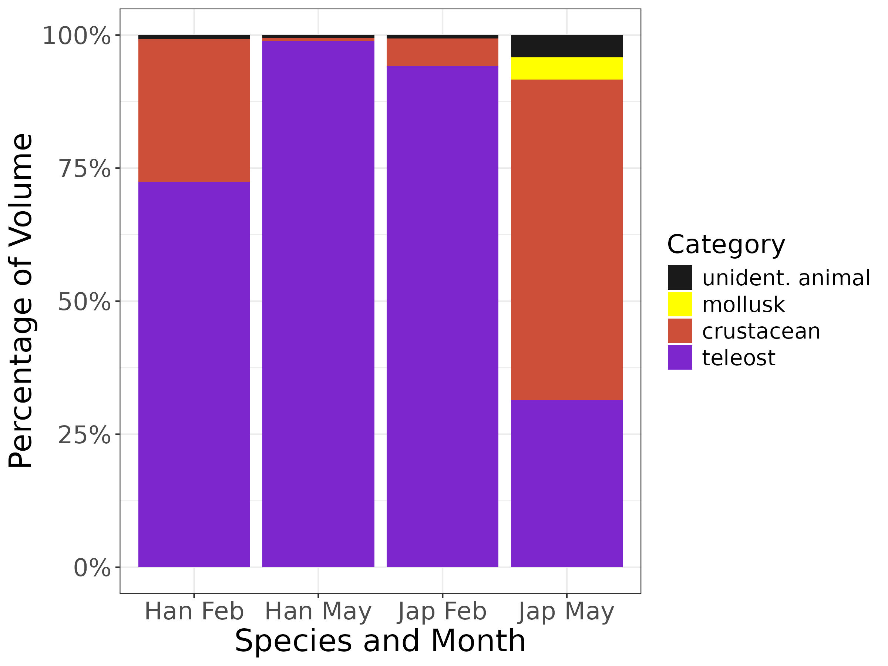

# Acropoma Diet Partitioning

Analysis code for **trophic resource partitioning between two deep-sea glowbellies, *Acropoma hanedai* and *A. japonicum*, off southwestern Taiwan.** 

📄 Published in *Environmental Biology of Fishes* (2026), 109:43: [doi:10.1007/s10641-026-01814-y](https://link.springer.com/article/10.1007/s10641-026-01814-y)


The exact code behind the paper is archived on Zenodo ([doi:10.5281/zenodo.23901160](https://doi.org/10.5281/zenodo.23901160)) and tagged [`v1.0-paper`](https://github.com/kriggithub/Acropoma_Diet_Partitioning/releases/tag/v1.0-paper). `main` has been cleaned up since; any changes to results are noted below.

[](https://doi.org/10.5281/zenodo.23901160)



📄 **[Read the full analysis report](https://kriggithub.github.io/Acropoma_Diet_Partitioning/FishDataAnalysis.html)**

## Motivation

This study aimed to describe the diets of *Acropoma hanedai* and *Acropoma japonicum* and test whether they exhibited resource partitioning.

## Questions

1. Do the two species differ in length by season (February vs. May)?
2. Is the presence of stomach contents biased by size, species, or month?
3. How does diet composition (by biovolume and frequency of occurrence) differ between species, months, and size classes?
4. Can we predict the occurrence of key prey groups (crustaceans, fish) from species, season, and size?

## Main Methods

- **Mixed models** (`glmmTMB`): Gaussian and binomial GLMMs with a random effect for specimen jar
- **Multivariate diet composition** (`vegan`): Bray–Curtis dissimilarity and PERMANOVA (`adonis2`)
- **Diet indices**: Index of Relative Importance (IRI), niche breadth and niche overlap
- **Sampling completeness**: species accumulation curves

## Key Findings

- *Acropoma japonicum* were significantly larger than *Acropoma hanedai* across both February and May (p = 0.001), and both species tended to be larger in May (p < 0.001).
- There was no significant effect of size, species, or month on the presence of stomach content (AIC Null Model = 234, AIC Fit Model = 241).
- The interaction of species and month had a significant effect on diet composition, even after accounting for variation in size classes. This was the case for both analyses of biovolume (p = 0.001) and frequency of occurrence (p = 0.001). 
- Analyzing the two largest diet groups (fish and crustaceans), *Acropoma japonicum* in May and *Acropoma hanedai* in February had a significant positive interaction with odds of crustaceans (p < 0.001) while having a negative interaction with the odds of fish (p = 0.006). The opposite was true for *Acropoma japonicum* in February and *Acropoma hanedai* in May.

## Repository contents

| File | Description |
|---|---|
| `R/fishdatacleaning.R` | Data cleaning R script |
| `FishDataAnalysis.Rmd` | Full analysis: models, PERMANOVA, IRI, niche metrics and figures |
| `FishDataAnalysis.html` | Rendered analysis report |
| `data/Ahandietadj.csv`, `data/Ajapdietadj.csv` | Raw stomach-content data for each species |
| `data/fish_data_long.csv`, `data/fish_data_long_summed.csv`, `data/fish_data_wide.csv` | Cleaned analysis datasets |
| `figures/*.png`, `figures/*.jpg` | Figures and tables (`bw` = greyscale, `col` = colour versions) |


## Citation

> Ghedotti MJ, Riggin KL, Marsh MA, Bramlett SA, Pearson HD, Rodriguez GJ, Gruber JN, Egan JP, Voss KA (2026). Evidence of deep-sea trophic resource partitioning between the glowbellies *Acropoma hanedai* and *A. japonicum* near Southwestern Taiwan. *Environmental Biology of Fishes* 109:43. https://doi.org/10.1007/s10641-026-01814-y

```bibtex
@article{ghedotti2026acropoma,
  title   = {Evidence of deep-sea trophic resource partitioning between the glowbellies {Acropoma hanedai} and {A. japonicum} near Southwestern Taiwan},
  author  = {Ghedotti, Michael J. and Riggin, Kurt L. and Marsh, Milo A. and Bramlett, Sarah A. and Pearson, Hayden D. and Rodriguez, Gabriel J. and Gruber, Josephine N. and Egan, Joshua P. and Voss, Kristofor A.},
  journal = {Environmental Biology of Fishes},
  volume  = {109},
  pages   = {43},
  year    = {2026},
  doi     = {10.1007/s10641-026-01814-y}
}
```

## Author

**Kurt Riggin** (analysis code): [GitHub](https://github.com/kriggithub) · [ORCID](https://orcid.org/0009-0004-4700-1251)

**Statistical skills:** generalized linear mixed models with random intercepts for clustered data, logistic regression with interactions for binary outcomes, linear contrasts with back-transformed 95% CIs, permutation-based multivariate testing (PERMANOVA), binomial-proportion confidence intervals

